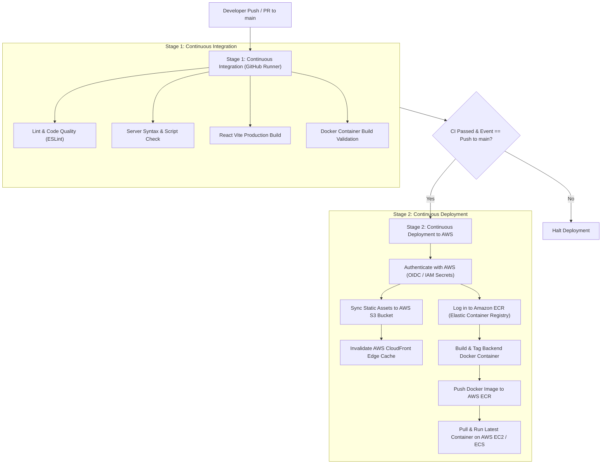

# 🚀 HirePilot — AI-Powered Mock Interview Platform

[](https://react.dev/)
[](https://nodejs.org/)
[](https://www.mongodb.com/)
[](https://aws.amazon.com/)
[](https://www.docker.com/)
[](https://github.com/features/actions)
[](https://tailwindcss.com/)
[](LICENSE)

> **HirePilot** is a production-grade full-stack MERN application that provides candidates with real-time, personalized AI mock interviews. It evaluates spoken answers on **Confidence, Communication, and Correctness**, featuring dynamic speech interaction, animated avatar feedback, automated performance analytics, an integrated **AWS Cloud infrastructure**, and automated **GitHub Actions CI/CD pipeline**.

---

## 🌟 Key Features

- 📄 **Resume Parsing & Skill Extraction:** Upload a PDF resume to automatically extract candidate role, experience level, tech stack, and key projects via `pdfjs-dist` and LLM extraction.
- ☁️ **AWS S3 Cloud Storage:** Candidate resumes are processed and archived with scalable, durable object storage via **AWS S3** (`@aws-sdk/client-s3`).
- 🎙️ **Voice Interview Engine (Speech-to-Speech):**
  - **Text-to-Speech (TTS):** Browser-native `speechSynthesis` vocalizes questions with natural human cadence.
  - **Speech-to-Text (STT):** Continuous transcription via `webkitSpeechRecognition` into real-time answer text.
  - **Acoustic Echo Prevention:** Deterministic microphone mute state machine prevents audio loops while the avatar speaks.
- ⏱️ **Real-Time Timed Rounds:** Customizable countdown timers per question (60s–120s) with auto-submission triggers.
- 🤖 **Multi-Dimensional AI Scoring:** Answers are evaluated across three rubrics: *Confidence*, *Communication*, and *Correctness* (0–10 scale) with concise, human-style feedback.
- 📊 **Analytics Dashboard & PDF Export:** Comprehensive visual breakdown with Recharts area curves, skill progress rings, and one-click downloadable PDF reports generated client-side via `jsPDF`.
- 💳 **Credit Economy & Payments:** Built-in credit wallet (50 credits per interview, 100 free on signup). Integrated with **Razorpay** checkout backed by server-side **HMAC-SHA256 cryptographic verification**.
- 🔐 **Stateless Authentication:** Firebase Google OAuth frontend handshake paired with secure, stateless 7-day `httpOnly` JWT session cookies on Express.
- 🔄 **Automated CI/CD Pipeline:** Fully automated testing, linting, Docker image building, and multi-tier AWS deployments via GitHub Actions.

---

## 🏗️ System & Cloud Architecture

```text
+-----------------------------------------------------------------------------------+
|                           BROWSER (Client Machine)                                |
|                                                                                   |
|  [ React 19 SPA ]  <--->  [ Redux Toolkit ]  <--->  [ Web Speech API ]            |
|  (Served via AWS           (User Profile &            (speechSynthesis &          |
|   CloudFront CDN)           Wallet Credits)            SpeechRecognition)         |
|                                                                                   |
|  [ Firebase SDK ] (Google OAuth)            [ Razorpay Checkout ] (Script Popup)  |
+--------------------------------------|--------------------------------------------+
                                       | HTTPS / REST + JWT Cookie
                                       v
+-----------------------------------------------------------------------------------+
|                        AWS CLOUD INFRASTRUCTURE                                   |
|                                                                                   |
|   +---------------------------------------------------------------------------+   |
|   |                  DOCKER CONTAINER ON AWS EC2 / ECS                        |   |
|   |                                                                           |   |
|   |   Express 5 API Server (Node.js 20)                                       |   |
|   |   ├── CORS & Parsers (json, cookieParser)                                 |   |
|   |   ├── isAuth Gate (JWT Verification & req.userId)                         |   |
|   |   ├── Multer Stream Pipeline                                              |   |
|   |   └── Controllers: Auth | Interview | Payment | User                      |   |
|   +-------------------|-------------------------------|-----------------------+   |
|                       |                               |                           |
|                       v                               v                           |
|             [ AWS S3 Bucket ]               [ MongoDB Atlas ]                     |
|             (hirepilot-resumes)             - Users (credits)                     |
|             - Resumes Archive               - Interviews (+Questions)             |
|             - Durable Storage               - Payments Audit                      |
|                                                                                   |
|                       v                               v                           |
|             [ OpenRouter Gateway ]          [ Razorpay Cloud ]                    |
|             - gpt-4o-mini LLM               - Order & Webhooks                    |
+-----------------------------------------------------------------------------------+
```

---

## 🔄 Automated CI/CD Pipeline (GitHub Actions & AWS)

The repository includes a production-grade Continuous Integration and Continuous Deployment pipeline configured in [`.github/workflows/ci-cd.yml`](.github/workflows/ci-cd.yml).



### CI/CD Highlights:
1. **Zero-Downtime Cache Invalidation:** Whenever frontend changes are pushed, the pipeline syncs assets to S3 and automatically issues an `aws cloudfront create-invalidation --paths "/*"` command so users worldwide immediately receive the new version without stale asset errors.
2. **Containerized Immutability:** The backend is packaged into a secure, minimal **Node.js 20 Alpine** Docker image and pushed to Amazon ECR, guaranteeing identical execution between local testing and AWS production.
3. **Automated Quality Gates:** Pull requests cannot be merged if frontend linting, syntax validation, or container compilation fails.

---

## 🛠️ Tech Stack Breakdown

| Layer | Technologies | Role / Rationale |
| :--- | :--- | :--- |
| **Frontend** | React 19, Vite | Fast modular SPA with instant HMR and component-driven architecture. |
| **Styling** | Tailwind CSS v4 | Modern utility-first styling with `@tailwindcss/vite`. |
| **State Management**| Redux Toolkit | Centralized store for user profile and wallet credits, eliminating prop drilling. |
| **Routing** | React Router DOM v7 | Client-side routing across setup, interview room, history, and report views. |
| **Data Viz / PDF** | Recharts, jsPDF | Interactive performance trend charts and browser-side PDF report rendering. |
| **Backend API** | Node.js, Express 5 | High-throughput asynchronous event-driven REST API. |
| **Database** | MongoDB Atlas, Mongoose 9| Document store with embedded question subdocuments for $O(1)$ single-read queries. |
| **Cloud Storage** | AWS S3 (`@aws-sdk/client-s3`) | Durable, decoupled cloud object storage for candidate resumes. |
| **Cloud CDN** | AWS CloudFront | Global edge distribution network serving frontend assets with sub-50ms latency. |
| **Containerization**| Docker, Docker Compose | Multi-stage production container builds running as non-root user for security. |
| **CI / CD** | GitHub Actions | Automated build, test, container push to Amazon ECR, and cloud deployment. |
| **AI Layer** | OpenRouter (GPT-4o-mini)| Low-latency LLM gateway for resume analysis, question drafting, and grading. |
| **Payments** | Razorpay + Node Crypto | Secure checkout with server-side HMAC-SHA256 signature validation. |

---

## 📂 Repository Structure

```text
hirepilot/
├── .github/
│   └── workflows/
│       └── ci-cd.yml           # Automated GitHub Actions CI/CD Pipeline for AWS
├── client/                     # Frontend React application
│   ├── public/                 # Static assets and icons
│   ├── src/
│   │   ├── assets/             # Avatar video clips and illustrations
│   │   ├── components/         # Reusable UI (Navbar, Timer, Step Cards)
│   │   ├── pages/              # Route views (Home, Interview, Report, Pricing)
│   │   ├── redux/              # RTK store and user slice
│   │   ├── utils/              # Firebase initialization
│   │   ├── App.jsx             # Route definitions and session hydration
│   │   └── main.jsx            # React root mount
│   ├── Dockerfile              # Multi-stage production Nginx container
│   ├── nginx.conf              # SPA routing fallback & gzip compression
│   ├── vite.config.js          # Vite + Tailwind v4 config
│   └── package.json
│
├── server/                     # Backend Express API
│   ├── config/                 # DB connection and token signers
│   ├── controllers/            # Core business logic (interview, payment, auth)
│   ├── middlewares/            # isAuth gate, multer upload filters
│   ├── models/                 # Mongoose schemas (User, Interview, Payment)
│   ├── routes/                 # REST route declarations
│   ├── services/               # OpenRouter, Razorpay, and AWS S3 services
│   │   ├── openRouter.service.js
│   │   ├── razorpay.service.js
│   │   └── s3.service.js       # AWS S3 upload and retrieval engine
│   ├── Dockerfile              # Production Node 20 Alpine container
│   ├── index.js                # Server entry point & middleware chain
│   └── package.json
│
└── docker-compose.yml          # Local & production multi-container orchestration
```

---

## 🔌 API Endpoints Reference

| Method | Endpoint | Protection | Description |
| :--- | :--- | :--- | :--- |
| `POST` | `/api/auth/google` | Public | Google OAuth handshake: finds or creates user and sets JWT cookie. |
| `GET` | `/api/auth/logout` | Public | Clears session cookie and invalidates browser session. |
| `GET` | `/api/user/current-user`| `isAuth` | Hydrates current logged-in user profile and balance on app mount. |
| `POST` | `/api/interview/resume` | `isAuth` + `multer` | Extracts text from uploaded PDF and syncs with AWS S3 cloud storage. |
| `POST` | `/api/interview/generate-questions` | `isAuth` | Deducts 50 credits and drafts 5 role-specific interview questions. |
| `POST` | `/api/interview/submit-answer` | `isAuth` | Grades individual answer (0–10) with AI feedback and persists subdocument. |
| `POST` | `/api/interview/finish` | `isAuth` | Aggregates all scores and marks interview completed. |
| `GET` | `/api/interview/get-interview` | `isAuth` | Retrieves user's interview history (projected for high speed). |
| `GET` | `/api/interview/report/:id` | `isAuth` | Retrieves full analytics report for a specific interview. |
| `POST` | `/api/payment/order` | `isAuth` | Creates a Razorpay order ID for purchasing credit packs. |
| `POST` | `/api/payment/verify` | `isAuth` | Cryptographically validates HMAC-SHA256 signature and adds credits. |

---

## 🐳 Running with Docker & Docker Compose

To run the entire full-stack application (Frontend + Backend) locally with a single command:

```bash
docker-compose up --build
```
- Frontend UI: `http://localhost:80`
- Backend API: `http://localhost:8000`

---

## ⚙️ Local Development Setup

### 1. Prerequisites
- Node.js (v18 or higher)
- MongoDB Atlas cluster URL
- Firebase Web App credentials
- OpenRouter API key
- Razorpay test mode credentials
- AWS Account (Optional, for S3 and deployment workflows)

### 2. Clone the Repository
```bash
git clone https://github.com/Roshanraj2580/hirepilot.git
cd hirepilot
```

### 3. Server Configuration
```bash
cd server
npm install
```
Create a `.env` file inside `/server`:
```env
PORT=8000
MONGODB_URL=your_mongodb_connection_string
JWT_SECRET=your_jwt_secret_key
OPENROUTER_API_KEY=your_openrouter_api_key
RAZORPAY_KEY_ID=your_razorpay_key_id
RAZORPAY_KEY_SECRET=your_razorpay_key_secret

# AWS Cloud Configuration (Optional / Production)
AWS_REGION=ap-south-1
AWS_ACCESS_KEY_ID=your_aws_access_key
AWS_SECRET_ACCESS_KEY=your_aws_secret_key
AWS_S3_BUCKET_NAME=hirepilot-resumes
```
Start backend:
```bash
npm run dev
```

### 4. Client Configuration
```bash
cd ../client
npm install
```
Create a `.env` file inside `/client`:
```env
VITE_SERVER_URL=http://localhost:8000
VITE_FIREBASE_APIKEY=your_firebase_api_key
VITE_RAZORPAY_KEY_ID=your_razorpay_key_id
```
Start frontend:
```bash
npm run dev
```
Open [http://localhost:5173](http://localhost:5173) in Chrome or Edge.

---

## 🛡️ Cloud & Engineering Interview Talking Points

- **Why AWS S3 over Server Disk Storage?** In a modern cloud environment with autoscaling containers (AWS ECS/EC2), servers are ephemeral and stateless. Storing uploaded resumes on local disk fails when multiple server instances run behind a load balancer, because an instance cannot read files saved on a peer instance. AWS S3 provides high-durability (99.999999999%) centralized object storage.
- **Why AWS CloudFront with S3 for React?** Instead of using a Node.js server to serve static HTML/JS/CSS files, serving the React SPA from an S3 bucket fronted by AWS CloudFront caches static assets at edge locations worldwide, reducing latency to $<50\text{ms}$ while completely removing static file load from the backend API.
- **Why Multi-Stage Docker Builds?** In `client/Dockerfile`, we use Node 20 only to build the production bundle (`dist`), then copy the static output into a lightweight Nginx Alpine container. This reduces the container image size from $\sim 1\text{GB}$ to under $25\text{MB}$, saving storage and speeding up deployment pull times in the CI/CD pipeline.
- **Cryptographic Payment Integrity:** Razorpay transactions verify authenticity on the server by recomputing `HMAC-SHA256(order_id + "|" + payment_id, SECRET)` before modifying wallet balances.

---

## 👨‍💻 Author

**Roshan Raj**  
B.Tech ECE · BIT Mesra  
- GitHub: [@Roshanraj2580](https://github.com/Roshanraj2580)
- Project Repository: [hirepilot](https://github.com/Roshanraj2580/hirepilot)

---
*Built with ❤️ for tech candidates preparing for placements.*
